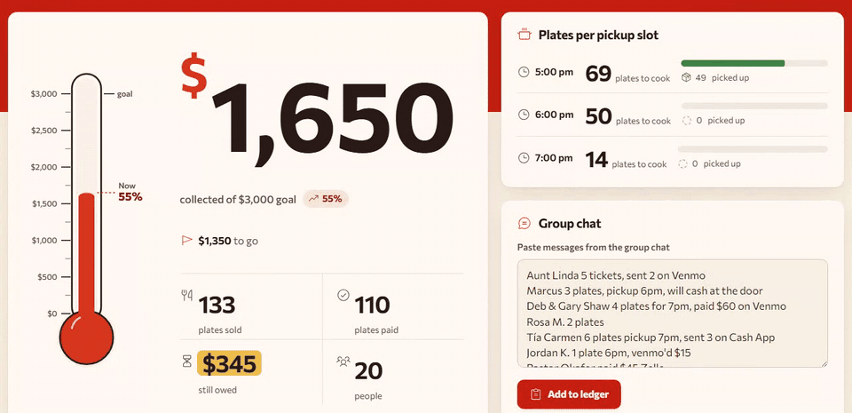
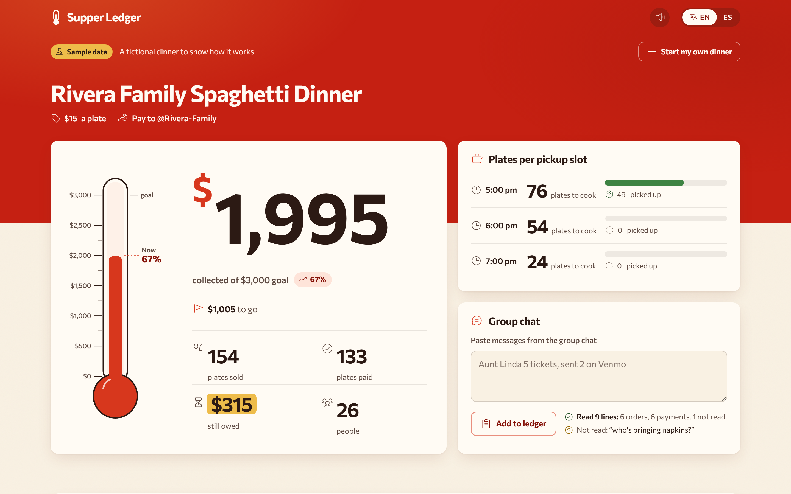
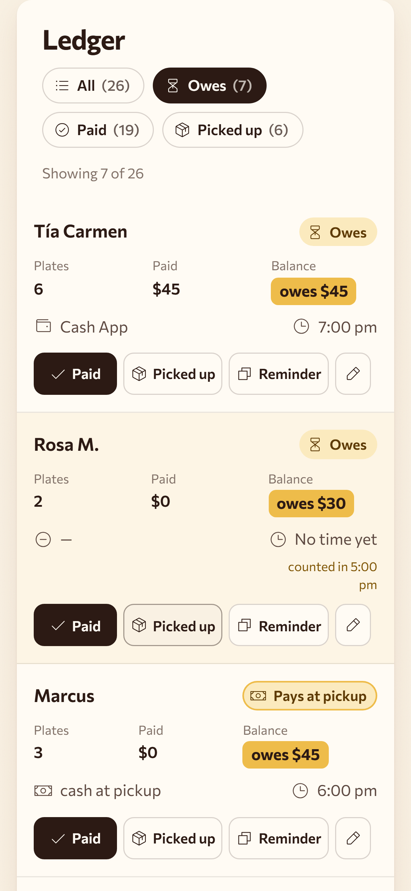
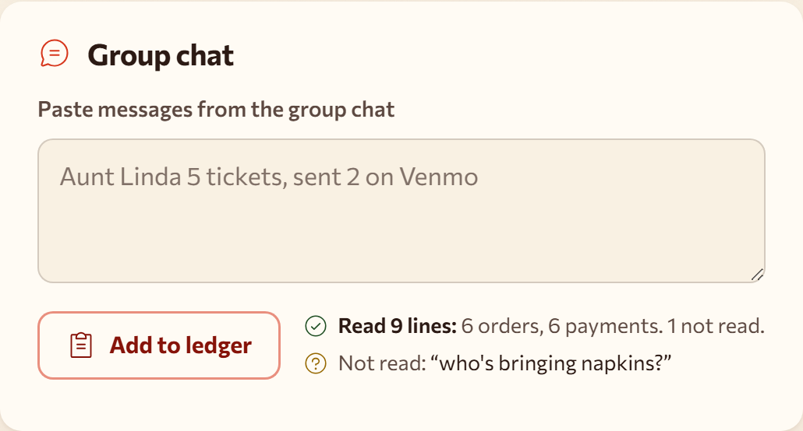
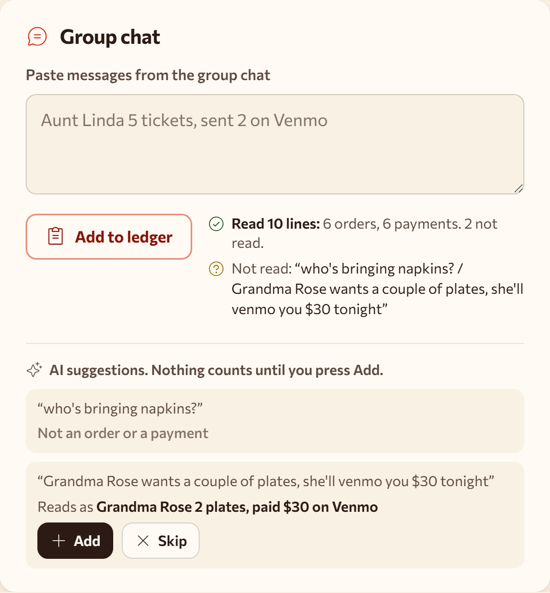
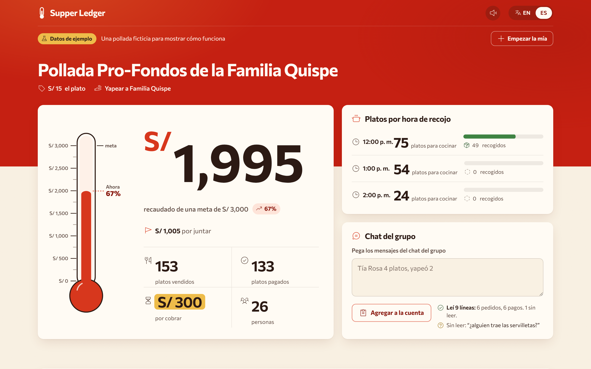

# Supper Ledger

**When a family sells plates to cover a hospital bill, the orders arrive as group-chat messages, and on the night one relative scrolls back and adds it all up by hand.** Supper Ledger reads the pasted chat and shows money collected against the goal, plates to cook for each pickup time, and who still owes.

**Live app:** https://kasbsquall.github.io/supper-ledger/
**Demo video:** coming soon

No sign-up and no server. Everything stays in the browser on the organizer's phone, and AI is there only when the organizer asks for it.



## Who it's for

The relative who ends up running the dinner: one person, often not technical, keeping track of a few hundred plates sold by many relatives at once, with payments spread across Venmo, Zelle, Cash App and cash. It fits any dinner sold by the plate with pickup times: spaghetti dinners, church fish fries, bake sales for a medical bill, and the Peruvian *pollada pro-fondos* that inspired it.

## Try it in a minute

1. Open the live app and press **Try the sample dinner**. The board is labeled "Sample data": it is a fictional spaghetti dinner already in progress.
2. The newest chat messages wait in the paste box. Press **Add to ledger** and watch the thermometer go from $1,650 to $1,995.
3. Type a line of your own, for example `Grandpa Joe 2 plates @ 7, zelled $30`, and add it. He lands in the 7:00 pm slot, paid in full.
4. Type a line the rules can't read, like `Grandma Rose wants a couple of plates, she'll venmo you $30 tonight`, then press **Ask AI about this line** with your own Anthropic API key. The AI suggests `Grandma Rose 2 plates, paid $30 on Venmo`, and it only counts when you press **Add**.
5. At the pickup table, use **Paid**, **Picked up** and **Reminder** on any row. Every action can be undone.
6. Switch to **ES** for the Spanish version, with soles, Yape and Plin and a sample pollada.

<table>
  <tr>
    <td width="68%"></td>
    <td width="32%"></td>
  </tr>
  <tr>
    <td>The board answers the three questions of the night: how close to the goal, how many plates for each pickup time, and who still owes.</td>
    <td>At the pickup table, on the phone: filter to who still owes and tap.</td>
  </tr>
</table>

## It reads the chat, and never guesses

The reader is rule-based (`src/ledger/parse.ts`), so it works offline and gives the same answer every time. It reads lines like these:

```text
Aunt Linda 5 tickets, sent 2 on Venmo
Marcus 3 plates, pickup 6pm, will cash at the door
Deb & Gary Shaw paid $60 on Zelle
Grandpa Joe 2 plates @ 7, zelled $30
Tía Rosa 4 platos, yapeó 2
Don Lucho 3 polladas, paga al recoger a la 1
```

A number after "sent" or "paid" counts plates; an amount with `$` or `S/` counts money. Pickup times snap to the nearest slot, and a line already added is skipped, so pasting overlapping chat is safe.

A line it can't read is shown back to the organizer, word for word, and the ledger is left alone:



### When the rules can't read a line, AI can help

This part is optional. For the lines left in "Not read", the organizer can ask AI. Only those lines go to Anthropic, with the organizer's own API key, which stays in memory while the page is open and is never saved. The model rewrites each line into a form the rule-based reader already knows; the reader still decides what it means, and nothing counts until the organizer presses **Add**. A line like "who's bringing napkins?" comes back as "Not an order or a payment".



The code is in `src/ledger/ai.ts` (official Anthropic SDK, loaded only when asked, model `claude-opus-5-5` at low effort with structured JSON output).

## Private by design

The names and debts never leave the device. With the network switched off after the page loads, pasted lines still land, and the only network activity is the app asking for its own sound files. The one exception is the optional AI reading above, which sends only the not-read lines, and only when the organizer asks.

## En español



## Run it locally

Requires Node 20.19 or newer.

```bash
npm install
npm run dev
```

Open the address it prints and add `/supper-ledger/` if it isn't there. Other commands:

```bash
npm test
npm run build
```

`npm test` runs 35 numbered tests that map to the acceptance criteria in `devpost/prd.md`.

## How it was planned

This project was built with the Devpost Build With AI: Basics learning pack. The planning documents are kept in `devpost/`:

- `scope.md`: the kernel and what was cut
- `prd.md`: the journey, behaviors and acceptance criteria
- `spec.md`: stack, data model and file structure
- `checklist.md`: build slices, final review and the revisions the build forced
- `app-map.html`: a short guide to where things live in the code

## Built with

Vite, React and TypeScript, tested with Vitest. Optional AI reading with the Anthropic API through the official TypeScript SDK. Icons: Phosphor (MIT). Animated figures: Number Flow (MIT). Font: Commissioner (SIL Open Font License). Sounds: Kenney Interface Sounds (CC0, see `public/sfx/LICENSE-kenney.txt`).

## License

MIT, see `LICENSE`.
